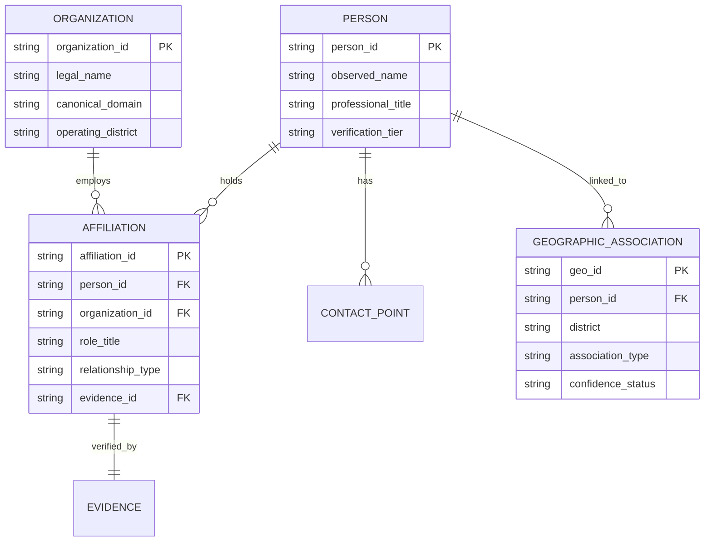

# MATRIX 360 — PEOPLE-FIRST DATA MODEL & RELATIONSHIP SPECIFICATION
**Directory:** `docs/director_acceptance_20261027/05_PEOPLE_ORGANIZATION_RELATIONSHIP_ACCEPTANCE.md`  
**Date:** 27 October 2026  
**Auditor:** Mayur (Principal AI Systems Engineer & Data Architect)  
**Status:** **IMPLEMENTED & VERIFIED**  

---

## 1. People-First Principle

Prior versions of Matrix 360 represented all leads primarily as corporate industrial entities, attempting to attach synthetic promoter names when named individuals were not present.

Under this P0 directive:
1. **People and decision-makers are first-class targets**, not merely company attributes.
2. An individual may be a prospective buyer, doctor, legal practitioner, founder, senior executive, or homebuyer regardless of whether their company is an industrial plant.
3. If only a corporate entity is verified without a published decision-maker, the engine outputs an **Organization candidate** and explicitly marks `PERSON_NOT_OBSERVED` rather than synthesizing an artificial managing director.
4. Surnames, car models, or postal areas are **never** used to infer caste, religion, personal net worth, or private property-buying intent.

---

## 2. Canonical Entity Data Model

---

## 3. Geographic Association Semantics

The engine explicitly distinguishes between distinct geographical relationship types:

| Association Type | Definition | Verification Standard | Example |
|---|---|---|---|
| `current_residence` | The individual currently lives in the target locality. | Address listed on official professional clinic or practice registry. | Dr. Subhashis Mukherjee practicing in Chandannagar. |
| `native_association` | The individual originates from or has established family roots in the locality, but currently resides elsewhere. | Declared profile education, alumni association, or documented corporate root. | Senior VP in Bangalore with documented Chandannagar roots. |
| `business_location` | The individual's workplace or plant is situated in the target district. | Physical manufacturing facility or office registration. | Plant Head operating in Jalan Industrial Complex, Howrah. |
| `expressway_commuter` | The individual travels along a regional transport corridor connecting two hubs. | Documented commercial operations or logistics hub along Kalyani Expressway. | Industrialist commuting between Kolkata and Nadia. |

---

## 4. UI Modes & Table Adaptation

The UI dynamically adapts its presentation based on the active client's mode:

### 4.1. People Mode (`👥 People Mode`)
* **Default For:** Shree Heights (Luxury Residential), Vrindavan Greens (Plotted Land).
* **Table Columns:** `#`, `Decision Maker & Role`, `Organization & Domain`, `District / Geo`, `Verified Contact`, `Source Origin`, `Tier`, `AI Fit Reasoning & Provenance`, `Action`.
* **Lead Display:** Prioritizes the individual's full name, clinical or executive role, direct telephone string, and specific local affinity.

### 4.2. Organization Mode (`🏢 Org Mode`)
* **Default For:** Lakhotia Industrial Complex, Matrix 360 Advisory, Apex Industrial Fleet.
* **Table Columns:** `#`, `Company & Promoter`, `Domain`, `District / Plant`, `Verified Contact`, `Source Origin`, `Sector / Industry`, `Turnover Scale`, `Tier`, `Action`.
* **Lead Display:** Prioritizes corporate name, plant/warehouse siding, observed fleet assets, and verified corporate switchboard/email.
