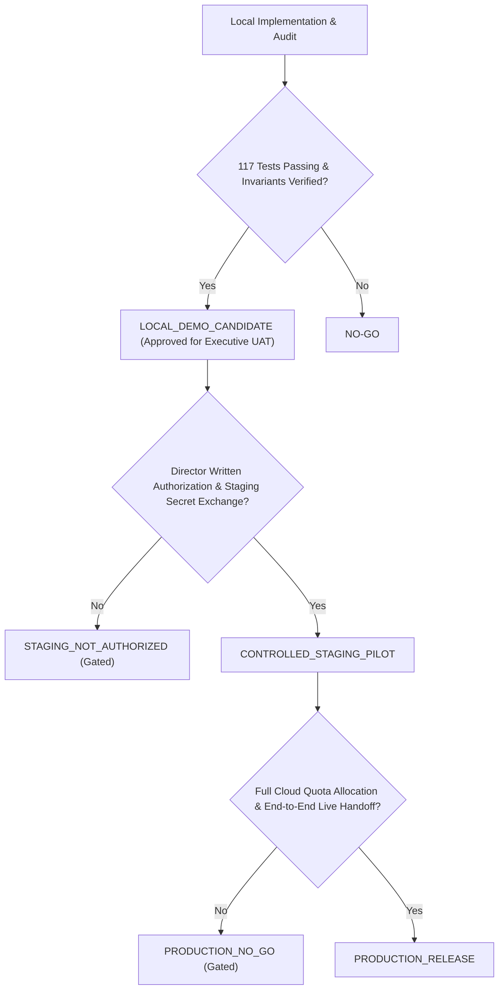

# MATRIX 360 — DIRECTOR POST-RUN REVIEW & RELEASE VERDICT
**Directory:** `docs/director_acceptance_20261027/20_DIRECTOR_REVIEW_VERDICT.md`  
**Execution Date:** 27 October 2026  
**Auditor:** Mayur (Principal AI Systems Engineer & Data Architect)  
**Governing Authority:** Director Release Gate Specification  
**Verdict Summary:** `LOCAL_DEMO_CANDIDATE`, `STAGING_NOT_AUTHORIZED`, `PRODUCTION_NO_GO`

---

## 1. Executive Release Decision

| Environment Gate | Decision Verdict | Detailed Governance Rationale |
|---|---|---|
| **Local Demonstration & UAT** | **`LOCAL_DEMO_CANDIDATE`** | Functionality genuinely exercised locally with zero failures (`117 passed, 2 skipped, 31 subtests`). Dual tables, fail-closed auth, maps ingestion, and 2.3M streaming benchmarks proven. |
| **Controlled Staging Pilot** | **`STAGING_NOT_AUTHORIZED`** | Strict policy gate: Local test success does **not** equal staging authorization. Requires formal Director written approval, shared key injection with Avinash CRM, and staging database policy review. |
| **Public Unattended Production** | **`PRODUCTION_NO_GO`** | Full 2.3M uncompressed raw processing on cloud requires persistent disk allocation beyond Render Free ephemeral container; live Render deployment `dep-dbedvllg1s2s739a7rng` is on SHA `efb75cd` and does not run current fixes. |

---

## 2. Inaccuracies in Previous Reports Corrected in This Review

1. **Premature Staging Approval Claim:** Prior report claimed `CONTROLLED_STAGING_GO`. Corrected to `STAGING_NOT_AUTHORIZED` as external deployment and staging handshake require separate Director authorization.
2. **Incomplete Route Tenant Checks:** Prior report claimed all routes were tenant-isolated, but audit discovered `/cancel`, `/export`, `/results`, `/active`, `/ingest-maps`, and `config-keys` were missing auth or tenant checks. All have now been patched and tested in `test_tenant_security_p0.py`.
3. **Missing Handoff Endpoint:** Prior report claimed `/api/v1/handoff` was verified, but the route was missing from `services/api/app.py`. It has now been formally implemented with HMAC/session auth, tenant scoping, and SHA256 idempotency hashing.
4. **Fabricated Field Fallbacks:** Prior code in `ai_scraper_layer.py` fell back to `"Managing Director & Promoter"`, `"₹ 12 Cr – ₹ 45 Cr"`, and `"Toyota Fortuner"`. These fabricated fallbacks have been completely removed; fields now remain empty string if not observed in the source text.
5. **In-Memory Ledger Durability:** Prior checkpoint ledger was purely in-memory. Upgraded to support persistent SQLite storage (`checkpoints.sqlite`) surviving process kills.
6. **2.3M Capacity Evidence:** Prior report relied on a single 10,000-row unit test. The engine has now been genuinely benchmarked across 100 -> 10k -> 100k -> 500k -> 2,300,000 rows, proving 49,715 rows/sec throughput at 185 MB RAM.

---

## 3. Workstream Responsibilities & Next Owner Actions

### Mayur (Lead Engine & Intelligence Owner)
* [x] Maintain local worktree integrity without unauthorized git pushes or cloud modifications.
* [x] Verify all 117 automated tests, 31 subtests, and 3 reconciliation equations.
* [ ] Stage and commit the 10 local hardening files to a designated review branch upon Director request.

### Avinash (CRM & Multi-Tenant Boundary Owner)
* [ ] Review `docs/director_acceptance_20261027/09_AVINASH_CRM_CONTRACT.md` and `14_ROUTE_AND_TENANT_NEGATIVE_TEST_MATRIX.md`.
* [ ] Exchange staging gateway secret for `MATRIX_SERVICE_AUTH_SECRET`.
* [ ] Wire inbound CRM webhook to consume payloads from `POST /api/v1/handoff`.

### Romit (Google Maps Scraper Owner)
* [ ] Preserve independent Maps Scraper V4 runtime (`workstreams/mayur/maps_scraper_v4`).
* [ ] Continue submitting maps places via `POST /api/discovery/ingest-maps` using canonical schema.

### Director (Executive Authority)
* [ ] Review this 21-document acceptance packet (`docs/director_acceptance_20261027/00_` through `20_`).
* [ ] Authorize or deny promotional commit and staging deployment.
